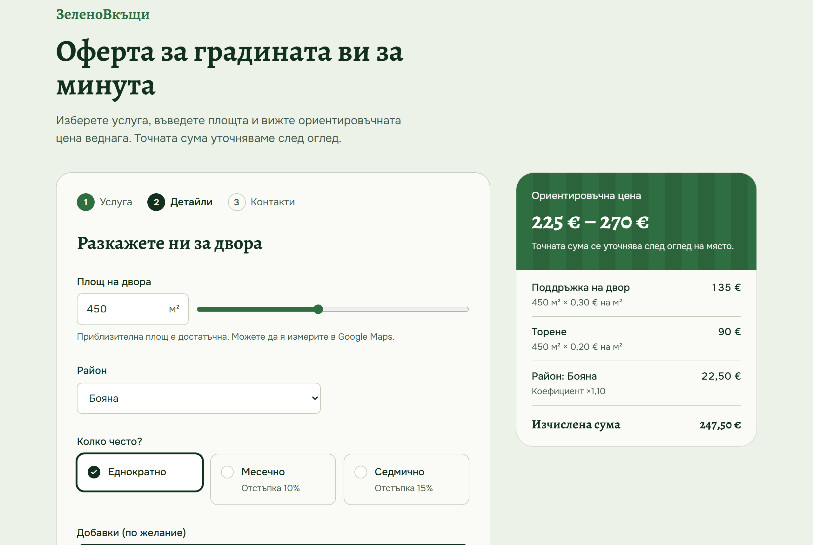
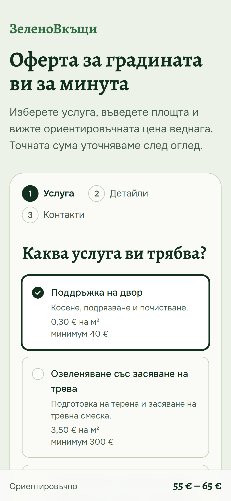
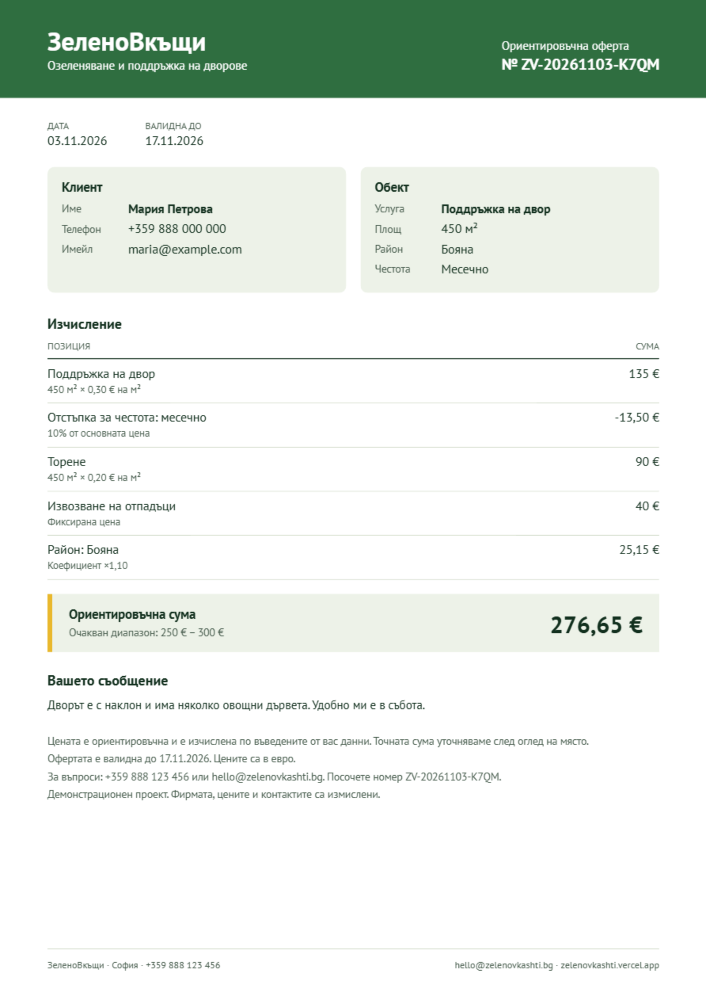
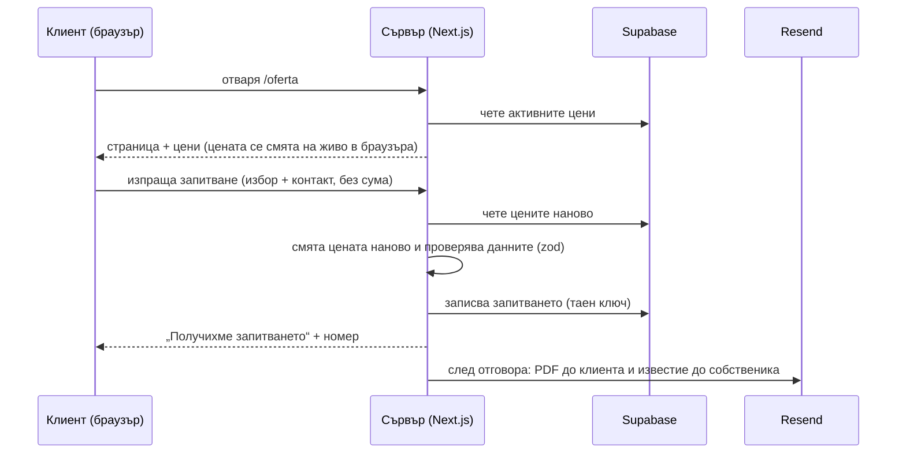

# ЗеленоВкъщи: оферта за градината за минута

Калкулатор за оферти за фирма за озеленяване. Клиентът избира услуга, площ и
район и **вижда цената веднага**. После оставя контакт и **до минута получава
PDF оферта по имейл**. Собственикът получава известие със същата оферта.

Фирмата е измислена, но проблемът е от реалния живот. Малките фирми в
България отговарят на запитвания след часове или дни, а клиентът междувременно
пише на конкурента. Този проект показва как запитването се превръща в
конкретна оферта, без собственикът да вдигне телефона.

**Демо на живо:** [zelenovkashti.vercel.app/oferta](https://zelenovkashti.vercel.app/oferta)
· калкулаторът е вграден в [сайта на фирмата](https://zelenovkashti.vercel.app)
(бутон „Изчислете цена“)

<p>
  
  
</p>

## Какво може

- **Цена на живо.** Всеки избор (площ, район, честота, добавки) веднага
  променя цената и разбивката: за какво плащаш и колко.
- **Три кратки стъпки.** Услуга → детайли → контакт. На телефон цената стои
  закрепена най-долу на екрана.
- **PDF оферта** с номер (`ZV-20261103-K7QM`), дата, срок на валидност и
  разбивка на цената. Прави се на сървъра и пристига като прикачен файл.
- **Два имейла** през Resend: офертата до клиента и известие до собственика.
  В известието телефонът и имейлът на клиента са връзки, които се отварят с едно
  натискане.
- **„По договаряне“.** За отдалечени райони и площи над 20 000 м² калкулаторът
  не дава сума, а предлага обаждане.
- **Цените са в базата, не в кода.** Собственикът сменя цена в Supabase и
  калкулаторът я показва веднага, без нова версия на сайта.



## Как работи



### Формулата

Всичко се смята в **цели центове**, за да няма грешки от закръгляне с дробни
числа (при тях `0.1 + 0.2` е `0.30000000000000004`).

```
основа = max(площ × цена на м², минимум на услугата)
сума   = (основа × (1 − отстъпка за честота) + добавки) × коефициент на района
```

Пример от снимката горе: 450 м² × 0,30 € = 135 €, плюс торене 90 €, по
коефициент 1,10 за Бояна, прави **247,50 €**. Клиентът вижда диапазон
±8%, закръглен на 5 €: **225 € – 270 €**. Точната сума се уточнява след оглед.

Формулата е **чиста функция** (`lib/pricing.ts`): получава каталога и избора
и връща резултат. Не чете база и не пипа екрана. Затова същият код върви и в
браузъра (цена на живо), и на сървъра (истинската цена), и лесно се тества.

## Интересните решения

**Сървърът не вярва на браузъра.** Браузърът показва цена, но при изпращане
праща само избора, не сумата. Сървърът чете цените от базата и смята всичко
наново. Иначе всеки с инструментите за разработчици в браузъра може да си
поръча оферта за 1 €.

**Базата е заключена с RLS** (Row Level Security, правила в самата база
кой какво може да чете и пише). Публичният ключ, който е видим в браузъра,
може само да чете активните цени. Запитванията с личните данни на клиентите
не се виждат с него. Пише в тях само сървърът с таен ключ, а ги чете само
потребител от таблицата `admins`.

**Имейлът не може да провали запитването.** Имейлите се пращат с `after()` от
Next.js, тоест след като клиентът вече е получил отговор. Ако Resend не
работи или PDF-ът се счупи, запитването пак е записано. Ако не стане PDF,
имейлът тръгва без него.

**Защита от ботове без досадна проверка.** Във формата има поле, скрито от
хората. Ботовете попълват всички полета и затова се издават, а сървърът
тихо ги отхвърля. Всичко, което клиентът пише, се обезврежда, преди да влезе в
HTML на имейла, за да не може някой да вкара връзка или скрипт в писмото до
собственика. Има тест за това.

**Бъг в библиотеката за PDF, хванат с тест.** При @react-pdf/renderer вторият
PDF, направен със същия шрифт, изглеждаше наред, но **копираният от него текст
излизаше разбъркан**. Причината е, че библиотеката преизползва вече зареден
шрифт, а таблицата „кой символ коя буква е“ остава от първия файл. Решението:
шрифтовете се регистрират наново преди всеки PDF и PDF-ите се правят един по
един (опашка). Тестът разархивира тези таблици от готовите файлове и проверява,
че няма празни места, включително при няколко едновременни заявки. Без
поправката тестът пада.

**Българско време навсякъде.** Номерът на офертата и срокът на валидност се
смятат по часовата зона `Europe/Sofia`. Сървърите на Vercel са на UTC, а
запитване в 1:30 през нощта не бива да излезе с вчерашна дата.

**Два отделни проекта, един адрес.** Сайтът на фирмата и калкулаторът са
отделни проекти във Vercel. Сайтът препраща всичко под `/oferta` към
калкулатора (Next.js нарича това *multi-zones*), затова посетителят остава
на същия адрес. Сайтът може да се променя (направен е с v0), без да счупи
калкулатора, и обратното.

## Технологии

| | |
|---|---|
| **Next.js 16** (App Router), **React 19**, **TypeScript** | страница, API и сървърна логика в един проект |
| **Tailwind CSS v4** | стилове |
| **Supabase** (Postgres + RLS) | цени и запитвания |
| **zod** | проверка на данните, които идват от браузъра |
| **@react-pdf/renderer** | PDF офертата, с шрифт PT Sans за кирилицата |
| **Resend** | имейлите |
| **Vercel** | хостинг |
| **node:test**, **tsx**, **esbuild** | тестове без допълнителни библиотеки |

## Тестове

31 теста, пускат се с `npm test`:

- **цени** (13): минимална цена, отстъпки за честота, добавки на м²,
  „по договаряне“, непознати услуги и райони, редовете да дават общата сума,
  форматиране на суми;
- **номер и дати** (7): формат на номера, българската дата (а не тази в UTC)
  през зимата и лятото, 14 дни валидност, края на годината, смяната на часа;
- **имейли** (6): съдържание, без споменаване на PDF, когато го няма, без
  чужд HTML;
- **PDF** (5): валиден файл на една страница, вграден шрифт с кирилица, верен
  копиран текст при PDF-и един след друг и едновременно.

## Структура

```
app/page.tsx                Страницата /oferta: чете цените от Supabase
app/api/quotes/route.ts     Приема запитване, смята цената наново, записва, праща имейли
components/Calculator.tsx   Калкулаторът: 3 стъпки, цена на живо
lib/pricing.ts              Формулата (чиста функция) + тестове
lib/catalog.ts              Четене на цените от базата
lib/supabase.ts             Публичен и таен клиент за Supabase
lib/quote-meta.ts           Номер на офертата и дати по българско време
lib/pdf/quote-pdf.tsx       PDF офертата
lib/email/                  Текст на имейлите и изпращане през Resend
supabase/schema.sql         Таблици, RLS правила и начални цени
assets/fonts/               PT Sans (лиценз OFL)
```

## Пускане на твоя компютър

Нужни са Node.js 20.9+ и безплатен акаунт в [Supabase](https://supabase.com).
За имейлите трябва и акаунт в [Resend](https://resend.com), но без него
калкулаторът пак работи.

1. `npm install`
2. В Supabase → **SQL Editor** пусни `supabase/schema.sql`. Той създава
   таблиците, правилата и началните цени.
3. Копирай `.env.example` като `.env.local` и попълни ключовете. Всяка
   променлива е обяснена във файла.
4. `npm run dev` и отвори http://localhost:3000/oferta

| Команда | Какво прави |
|---|---|
| `npm run dev` | стартира проекта за разработка |
| `npm test` | всички тестове |
| `npm run pdf:sample` | прави примерни PDF оферти в `out/` |
| `npm run lint` · `npx tsc --noEmit` | проверка на кода и на типовете |
| `npm run build` | production версия |

## Пускане онлайн и вграждане в сайт

1. Импортирай репото във Vercel и добави променливите от `.env.example` в
   **Settings → Environment Variables**.
2. Калкулаторът е на `https://<проект>.vercel.app/oferta`. Целият проект е под
   `/oferta` (`basePath`, стойността е в `lib/base-path.ts`).
3. В сайта, в който искаш да го вградиш, добави препращане. За Next.js това се
   слага в `next.config`:

```js
async rewrites() {
  return [
    { source: "/oferta", destination: "https://<проект>.vercel.app/oferta" },
    { source: "/oferta/:path*", destination: "https://<проект>.vercel.app/oferta/:path*" },
  ];
}
```

Вторият ред е за стиловете, скриптовете и API-то на калкулатора. Бутонът към
калкулатора трябва да е обикновен `<a href="/oferta">`, не `<Link>`, защото
двата проекта са отделни.

## Ограничения и следващи стъпки

- **Имейли.** Без собствен домейн Resend праща само до имейла на акаунта, затова
  в демото офертата стига само до собственика. С домейн (напр. `zelenovkashti.bg`)
  тя ще стига и до клиентите.
- **Админ панел.** Следва страница, на която собственикът вижда запитванията и
  сменя цените, без да влиза в Supabase. Правилата в базата вече са готови за
  нея (таблица `admins`).
- **По-силна защита от спам** с Cloudflare Turnstile.

---

<details>
<summary><b>In English</b></summary>

A quote calculator for a (fictional) landscaping company in Sofia. Customers pick
a service, area and district, see a live price breakdown, leave their contact and
receive a branded PDF quote by email within a minute; the owner is notified at the
same time.

Highlights: pricing is a pure function in integer cents, recomputed on the server
from database prices (the browser never sends an amount); Supabase RLS keeps
customer data private; emails are sent with Next.js `after()` so a failing email
never loses a lead; a test guards against a font-cache bug in @react-pdf/renderer
that scrambled copied text in subsequent PDFs; the calculator is a separate Vercel
project served under `/oferta` of the main site via multi-zone rewrites.

Stack: Next.js 16, React 19, TypeScript, Tailwind v4, Supabase, zod,
@react-pdf/renderer, Resend, Vercel. 31 tests with `node:test`.
</details>
